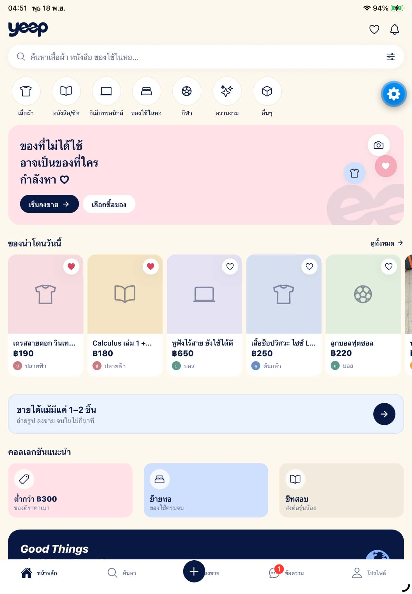
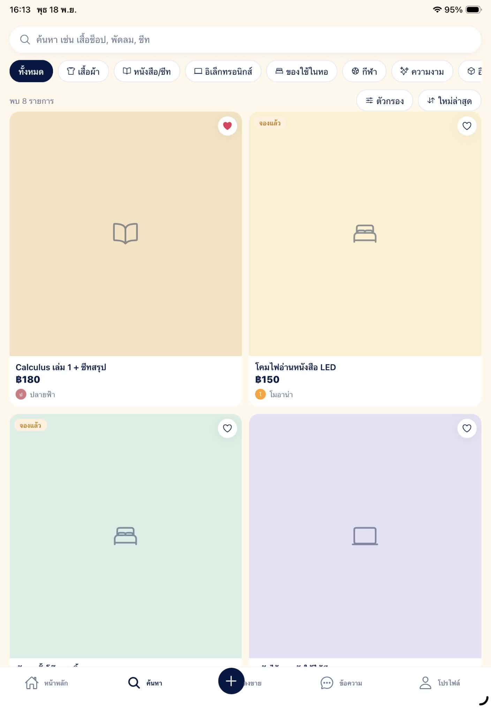
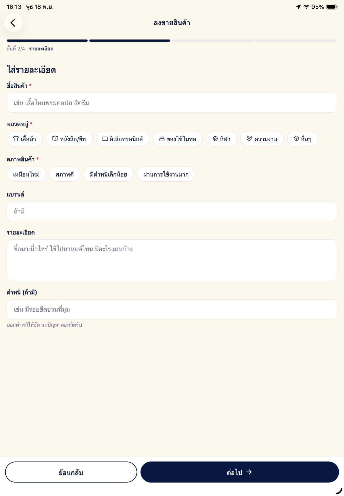
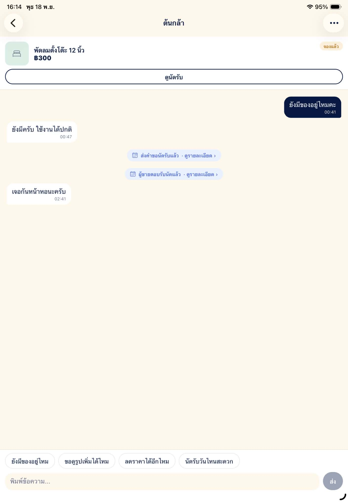
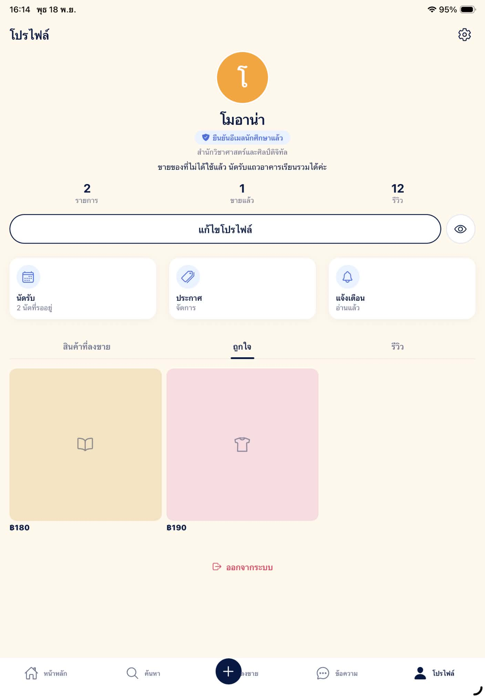

# YeEP — Second-hand Marketplace for SUT Students

YeEP is a mobile app for buying and selling second-hand items within **Suranaree University of Technology (SUT / มทส.)**. Students can list things they no longer need — clothes, textbooks and exam notes, electronics, dorm essentials — and arrange a safe, in-person meetup at a spot on campus.

> **Status:** Front-end prototype. All data currently comes from local mock data (`src/data/mock.js`); a real backend (planned: Supabase) is not connected yet.

## Features

- **Student-only sign-in** — login restricted to the university email domain (OTP is mocked during development)
- **Browse & search** — categories, curated collections (e.g. "Under ฿300", "Moving dorms", "Exam notes"), and filters by price and category
- **Sell** — create listings with photos (via `expo-image-picker`), price, condition, and category
- **Wishlist** — save items you're interested in
- **Chat** — message sellers directly from a listing
- **Campus meetups** — request a meetup at predefined on-campus spots and time slots, then track upcoming meetups
- **Trust & safety** — user profiles with ratings and reviews, reporting, and a safety-tips screen
- **Notifications, profile editing, and settings**

## Tech Stack

| Area | Technology |
| --- | --- |
| Framework | [Expo](https://expo.dev) SDK 58, React Native 0.88, React 19 |
| Language | JavaScript |
| Navigation | React Navigation 7 (bottom tabs + native stack) |
| State | React Context (`src/context/AppContext.js`) |
| UI | Custom design tokens (`src/theme.js`), `@expo/vector-icons` |
| Device APIs | `expo-image-picker`, `expo-font` |
| Backend (planned) | Supabase |

## My Role

This is a two-person project:

- **Design** — my teammate created the brand identity (logo, color palette, typography) and the UI designs for the key screens.
- **Development** — I built the entire app myself, turning those designs into a working mobile app.

What I did:

- Chose the tech stack (React Native + Expo, with Supabase planned as the backend)
- Developed all 21 screens — browse & search, listing detail, sell form, wishlist, chat, campus meetups, profile, reviews, reporting and settings — running on mock data so every flow can be demoed before the backend is ready
- Set up navigation with React Navigation (bottom tabs + native stack)
- Managed app state and actions with React Context (`AppContext`)
- Translated the design system into code: design tokens in `theme.js` (navy `#071943`, cream `#FFF8ED`, accent blue, pink) and reusable UI components
- Designed the screens and flows that weren't in the original mockups so the whole app stays consistent

## Getting Started

### Prerequisites

- [Node.js](https://nodejs.org) (LTS)
- The **Expo Go** app on your phone ([Android](https://play.google.com/store/apps/details?id=host.exp.exponent) / [iOS](https://apps.apple.com/app/expo-go/id982107779)), or an Android emulator / iOS simulator

### Run locally

```bash
git clone https://github.com/MojiEmika/yeep-marketplace.git
cd yeep-marketplace
npm install
npx expo start
```

Then scan the QR code with Expo Go (Android) or the Camera app (iOS), or press `a` / `i` / `w` in the terminal to open Android, iOS, or web.

### Demo login

Sign in with any email ending in `@g.sut.ac.th`. The mock verification code is `123456`.

## Project Structure

```
.
├── App.js                  # App entry: providers + navigator
├── app.json                # Expo config
├── assets/                 # App icons, splash, brand logos
└── src/
    ├── components/         # Reusable UI (ListingCard, shared UI pieces)
    ├── context/            # AppContext — app state & actions
    ├── data/               # Mock data (users, listings, meetup spots…)
    ├── navigation/         # Bottom tabs + stack navigator
    ├── screens/            # All app screens
    ├── utils/              # Formatting helpers
    └── theme.js            # Design tokens (colors, spacing, typography)
```

## Screenshots

| Home | Search & filters | Sell (step 2 of 4) |
| --- | --- | --- |
|  |  |  |

| Chat & meetup | Profile |
| --- | --- |
|  |  |
